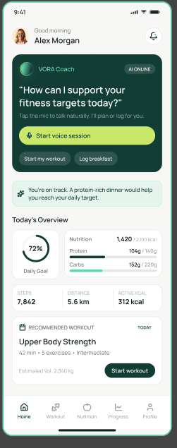
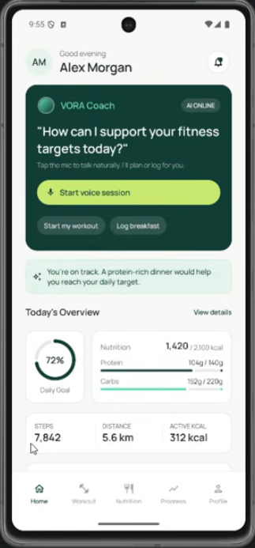
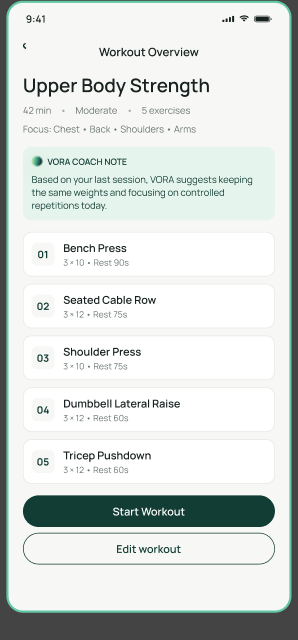
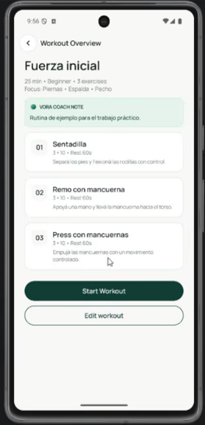

# VORA Coach — Parcial TP3

App Android (Kotlin + Jetpack Compose) basada en el diseño de VORA Coach.
Desarrollo de Aplicaciones Móviles — ORT 2026.

**Figma:** https://www.figma.com/design/1nvbbfYNYmKAevuaG28J85/Parcial-Domiciliario-7-Oct-26
**API:** https://tp3.martinrivas.ar/

## Integrantes
- Daiana Gimenez Torrico
- Francesca Rocío Massollo
- Nahuel Ezequiel Di Paolo

## Video de demostración
🎬 [Ver video](PEGAR_ENLACE_AL_VIDEO)

## Cómo ejecutar desde cero

### Requisitos
| | Recomendado |
|---|---|
| Android Studio | Última versión estable, con soporte para Android Gradle Plugin 9.3 |
| JDK | El que trae Android Studio (no hace falta instalar otro) |
| Dispositivo de prueba | Emulador **Pixel 8** con **Android 15 (API 35)**, imagen *Google APIs* |
| Versión mínima de Android | Android 7.0 (API 24) |
| Python (solo para el mock) | 3.9 o posterior |

### 1. Clonar el repositorio
1. En Android Studio: **File → New → Project from Version Control…** (o **Get from VCS** en la pantalla de bienvenida).
2. URL: `https://github.com/francescamassollo-ort/VoraCoach-Parcial.git`
3. Elegir una carpeta y tocar **Clone**. Si pregunta, confiar en el proyecto (**Trust Project**).

### 2. Sincronizar Gradle
- Al abrir, Android Studio sincroniza solo (barra de progreso abajo). La primera vez descarga Gradle y las dependencias: puede tardar varios minutos.
- Si no lo hace, o después de cambiar de rama: **File → Sync Project with Gradle Files** (ícono del elefante).
- Si aparece *"Unable to find Gradle tasks to build"* o algo parecido: volver a sincronizar; si sigue, **File → Invalidate Caches… → Invalidate and Restart**.

### 3. Crear el emulador
1. **Tools → Device Manager → Create Virtual Device** (o el **+**).
2. Elegir **Pixel 8**, imagen **API 35**, y terminar.
3. Arrancarlo con ▶ desde el Device Manager.

### 4. Ejecutar la app
En la barra de arriba, elegir la configuración **app** y el emulador, y tocar **Run** ▶ (`Shift+F10`).
La app arranca en **Sign In**: cualquier email y contraseña no vacíos sirven para entrar (el acceso es de demostración).

### 5. Servidor de la API
Por defecto la app usa la API publicada: `https://tp3.martinrivas.ar/`. No hace falta configurar nada.

Para usar el mock local del paquete del docente:
1. Con Python 3.9 o posterior, desde la carpeta del paquete: `python mock/server.py` (en macOS/Linux, `python3`).
2. Verificar en el navegador que responde en `http://localhost:8000/health`.
3. Agregar en `local.properties`, en la raíz del proyecto (es personal y no se sube al repositorio):
   ```
   vora.apiUrl=http://10.0.2.2:8000/
   ```
   `10.0.2.2` es la dirección de la compu vista desde el emulador.
4. Sincronizar Gradle y volver a ejecutar la app.

La conexión `http` (sin cifrar) se permite solo en la versión debug y solo hacia `10.0.2.2` y `localhost`.

Sin servidor, la pestaña Workout muestra lo que ya está guardado en Room. Si nunca se descargó, muestra un error con opción de reintentar.

### Versiones
| Componente | Versión |
|---|---|
| Gradle | 9.5.0 |
| Android Gradle Plugin | 9.3.3 |
| Kotlin | 2.2.10 |
| KSP | 2.3.12 |
| Compose BOM | 2026.02.01 |
| Navigation Compose | 2.9.0 |
| Hilt | 2.60.1 |
| Room | 2.7.1 |
| Retrofit | 2.11.0 |
| compileSdk / targetSdk | 35 |
| minSdk | 24 |
| Java | 11 |

## Estructura del proyecto
Paquete base: `app/src/main/java/com/example/voracoach/`

| Carpeta | Contenido |
|---|---|
| `navigation/` | Rutas (`AppDestination`), `AppNavHost`, barra inferior y pantalla provisoria |
| `ui/theme/` | Colores, tipografía y tema de la app |
| `ui/components/` | Componentes reutilizables (botones, tarjetas, campos) |
| `ui/screens/<área>/` | Pantallas de cada flujo: `auth`, `home`, `coach`, `workout`, `nutrition`, `progress`, `profile` |
| `viewmodel/` | ViewModels con el estado de cada pantalla |
| `data/remote/` | Retrofit: interfaz de la API y DTO |
| `data/local/` | Room: Entity, DAO y base de datos |
| `data/repository/` | Repositorios: única fuente de datos para los ViewModels |
| `model/` | Modelos que usa la app |
| `di/` | Módulos de Hilt que proveen Retrofit, Room y los DAO |

## Navegación
- La app arranca en **Sign In**. Al entrar se borra el acceso del historial: el botón atrás desde Home cierra la app.
- **Barra inferior** con 5 pestañas: Home, Workout, Nutrition, Progress y Profile. Cambiar de pestaña no apila pantallas: el botón atrás desde cualquiera vuelve a Home.
- La barra solo se muestra en las pestañas. Sign In, Sign Up, Notifications, Coach y las sub-pantallas (detalle, agregar, etc.) ocupan la pantalla completa.
- Las rutas que todavía no tienen pantalla real muestran una pantalla provisoria, para que todo el recorrido sea navegable.

### Decisiones de navegación (el Figma no define estos destinos)
Se eligieron según el contenido de cada pantalla:
- **Progress / 01 — Today's Overview:** se abre desde "View details" en la sección "Today's Overview" de Home. Tiene botón atrás porque no es una pestaña.
- **Progress / 02 — Dashboard:** "View" de Workout, Nutrition y Activity abre Workout Progress, Nutrition Progress y Health Trends; "See weekly review" abre Weekly Review.
- **Progress / 06 — Weekly Review:** "Get dinner ideas" lleva a la pestaña Nutrition, "View next week's plan" a Weekly Plan, "Ask VORA" a Coach y "Done" vuelve al Dashboard.
- Las sub-pantallas de Progress se muestran sin barra inferior, como las de Workout.
- El botón "•••" de las sub-pantallas de Progress no tiene menú en el Figma: muestra un aviso de función de demostración.

### Datos compartidos entre pantallas
- El nombre del perfil se ve en Home y los objetivos en Progress (Dashboard y Today's Overview). Los dos se leen de `ProfileRepository`: si se editan en Profile, se actualizan solos.
- El entrenamiento recomendado de Home y de Today's Overview es el primero del catálogo guardado en Room.
- El período elegido (Week, Month, 3 Months) y el macro de Nutrition Progress se guardan en el ViewModel, así que sobreviven a la rotación.

## Inventario de pantallas
🎭 Demostración: funciona sin servicio real · 🚧 Provisoria: ruta creada, pantalla en construcción · ⏳ Pendiente: sin ruta todavía · ✅ Funcional: con Retrofit o Room

### Acceso
| Pantalla (Figma) | Ruta | Estado |
|---|---|---|
| Login - 01 — SignIn | `sign_in` | 🎭 Demostración |
| Sign Up | `sign_up` | 🎭 Demostración |

### Home
| Pantalla (Figma) | Ruta | Estado |
|---|---|---|
| Home / 01 — Dashboard | `home` | 🎭 Demostración (métricas de ejemplo; nombre del perfil; entrenamiento recomendado real desde Room) |
| Home / 02 — Notifications | `notifications` | 🎭 Demostración (notificaciones de ejemplo; "Mark all as read" funcional) |

### Asistente VORA
Una pantalla con 6 estados simulados.

| Pantalla (Figma) | Ruta | Estado |
|---|---|---|
| Voice / 01 — Idle | `coach` | 🎭 Demostración |
| Voice / 02 — Listening | `coach` | 🎭 Demostración (transcripción simulada) |
| Voice / 03 — Processing | `coach` | 🎭 Demostración |
| Voice / 04 — Speaking | `coach` | 🎭 Demostración (respuesta y reproducción simuladas) |
| Voice / 05 — Conversation | `coach` | 🎭 Demostración (historial de la sesión; respuestas de ejemplo) |
| Voice / 06 — Error | `coach` | 🎭 Demostración (se llega tocando el mic antes de terminar la escucha; no pide permisos) |

### Workout
| Pantalla (Figma) | Ruta | Estado |
|---|---|---|
| Workout / 01 — Dashboard | `workout` | ✅ Funcional (catálogo con Retrofit y caché en Room) |
| Workout / 02 — Weekly Plan | `workout_weekly` | 🎭 Demostración (plan armado con el catálogo real; sugerencias simuladas) |
| Workout / 03 — Workout Details | `workout/{workoutId}` | ✅ Funcional (detalle con Retrofit y caché en Room) |
| Workout / 04 — Pre Workout | `workout/{workoutId}/pre` | 🎭 Demostración (nombre, duración y consejo del entrenamiento real) |
| Workout / 05 — Active Workout | `workout/{workoutId}/active` | 🎭 Demostración (ejercicios reales; series, peso y descanso simulados) |
| Workout / 06 — Exercise Details | `workout/{workoutId}/exercise/{exerciseId}` | 🎭 Demostración (instrucciones y consejo reales del ejercicio) |
| Workout / 07 — Workout Complete | `workout/{workoutId}/complete` | 🎭 Demostración (duración y ejercicios reales; volumen e insight de ejemplo) |

### Nutrition
| Pantalla (Figma) | Ruta | Estado |
|---|---|---|
| Nutrition / 01 — Dashboard | `nutrition` | 🎭 Demostración (comidas y totales de ejemplo, sin persistencia) |
| Nutrition / 02 — Today's Meals | — | ⏳ No implementada |
| Nutrition / 03 — Add Food | — | ⏳ No implementada |
| Nutrition / 04 — Voice Food Logging | — | ⏳ No implementada |
| Nutrition / 05 — Food Analysis | — | ⏳ No implementada |
| Nutrition / 06 — Photo Analysis | — | ⏳ No implementada |
| Nutrition / 07 — Food Confirmation | — | ⏳ No implementada |
| Nutrition / 08 — Meal Details | — | ⏳ No implementada |

### Progress
| Pantalla (Figma) | Ruta | Estado |
|---|---|---|
| Progress / 01 — Today's Overview | `progress_today` | 🎭 Demostración (métricas del día de ejemplo; entrenamiento real desde Room; objetivo y meta semanal del perfil) |
| Progress / 02 — Dashboard | `progress` | 🎭 Demostración (métricas de ejemplo por período; "Active goal" del perfil) |
| Progress / 03 — Workout Progress | `progress_workout` | 🎭 Demostración (volumen y ejercicios de ejemplo por período) |
| Progress / 04 — Nutrition Progress | `progress_nutrition` | 🎭 Demostración (objetivos por macro y hábitos de ejemplo) |
| Progress / 05 — Health Trends | `progress_health` | 🎭 Demostración (pasos y señales de hábito de ejemplo) |
| Progress / 06 — Weekly Review | `progress_weekly_review` | 🎭 Demostración (revisión de ejemplo; accesos reales a Nutrition, Weekly Plan y Coach) |

### Profile
| Pantalla (Figma) | Ruta | Estado |
|---|---|---|
| Profile / 01 — Dashboard | `profile` | 🚧 Provisoria |
| Profile / 02 — Edit Profile | a definir | ⏳ Pendiente |
| Profile / 03 — Goals & Preferences | a definir | ⏳ Pendiente |
| Profile / 04 — Nutrition Preferences | a definir | ⏳ Pendiente |
| Profile / 05 — Voice & AI Settings | a definir | ⏳ Pendiente |
| Profile / 06 — Settings | a definir | ⏳ Pendiente |

### Funciones simuladas del asistente
El asistente no usa reconocimiento de voz, IA ni audio reales, y nunca pide permiso de micrófono ni de cámara:
- **Escucha:** muestra una frase de ejemplo palabra por palabra. Tocar el mic antes de que termine lleva al estado de error.
- **Respuestas:** cada pregunta sugerida tiene una respuesta fija; lo que se escribe recibe respuestas de ejemplo que se van alternando.
- **Reproducción:** la barra de progreso avanza con un temporizador; pausa, repetir y detener funcionan sobre ese temporizador.
- **"Allow Access" y adjuntar (+):** muestran un aviso de función de demostración.
- La conversación vive en el ViewModel: sobrevive a la rotación, pero se pierde al salir de Coach.

## Estado de las funcionalidades

### Funcionales (con servicio o persistencia reales)
- **Catálogo y detalle de entrenamientos:** Retrofit contra la API, con caché en Room (offline-first). Room es la única fuente de datos y la red solo la actualiza.
- **Errores tipados de red:** sin conexión, error del servidor y respuesta inválida, cada uno con su mensaje y la opción de reintentar.
- **Navegación completa:** barra inferior, sub-pantallas, botón atrás, y rutas con parámetros (`workoutId`, `exerciseId`).
- **Estado que sobrevive a la rotación:** ViewModels con `StateFlow` y `rememberSaveable` para lo que se escribe.
- **Notificaciones:** "Mark all as read" apaga el aviso de la campana de Home.
- **Datos compartidos:** el nombre y los objetivos del perfil se ven en Home y en Progress.

### Simuladas (funcionan sin servicio real)
- **Acceso (Sign In / Sign Up):** no hay cuentas. Los campos se validan (obligatorios y largo mínimo de contraseña), pero cualquier dato válido permite entrar.
- **Asistente VORA:** ver "Funciones simuladas del asistente".
- **Métricas** de Home, Progress, Nutrition y Workout Complete: datos de ejemplo, porque la app no mide pasos, calorías ni sueño.
- **Botones sin destino en el Figma** ("•••", "Allow Access", adjuntar): muestran un aviso de función de demostración.
- **Permisos:** la app nunca pide permiso de micrófono ni de cámara.

### No implementadas
- **Registro de comidas** (carga manual, validación, listado por fecha, eliminación y total diario, con persistencia en Room) y las pantallas Nutrition 02 a 08.
- **Firebase:** el acceso es de demostración y los datos privados no se sincronizan con la nube.

## Comparaciones Figma vs. app
| Pantalla | Figma | App |
|---|---|---|
| Home / 01 — Dashboard |  |  |
| Workout / 03 — Workout Details |  |  |
| Voice / 04 — Speaking |  |  |
| Progress / 02 — Dashboard |  |  |
| Progress / 06 — Weekly Review |  |  |

## Uso de IA
Usamos Claude (Anthropic) como asistente durante todo el desarrollo. Todo lo que propuso
se revisó, se probó en el emulador y se adaptó antes de subirlo. El manejo de Git
(ramas, commits, pull requests y merges) lo hicimos nosotros.

### Cómo lo usamos
1. **Contexto inicial.** Le pasamos la consigna, el contrato de la API (`openapi.json`), las
   capturas del Figma y las buenas prácticas vistas en clase, para que sus propuestas las respetaran:
   - textos y colores en recursos (`strings.xml`, tema), nada hardcodeado;
   - navegación con callbacks: las pantallas no conocen el `NavController`;
   - estado en el ViewModel con `StateFlow` y flujo unidireccional (la pantalla avisa eventos, el ViewModel decide);
   - separación Route/Screen: la Screen no tiene estado y se puede previsualizar;
   - un repositorio como única fuente de datos para los ViewModels.
2. **Decisiones de arquitectura.** Le consultamos cuándo conviene cada forma de guardar datos, por ejemplo:
   - Room para registros (catálogo de entrenamientos, perfil);
   - DataStore para preferencias simples (sesión iniciada);
   - estado en memoria para lo que solo dura la sesión (conversación del Coach).
   Las decisiones las tomamos en equipo; en algunos casos elegimos lo más simple por el tiempo de entrega.
3. **Desarrollo por pasos chicos.** Cada pantalla o módulo se pidió por separado, con un plan
   previo de qué archivos cambiaban. Después de cada paso:
   - compilamos y probamos en el emulador (rotación, botón atrás, sin servidor);
   - revisamos el diff antes de hacer el commit;
   - un commit por paso, para poder volver atrás si algo se rompía.
4. **Errores y configuración.** Ayudó a diagnosticar errores de Gradle y de compatibilidad de
   versiones (Hilt y KSP con AGP 9), del emulador y de navegación (por ejemplo, el botón "Done"
   que no funcionaba al entrar desde Home).
5. **Aprendizaje.** Le pedimos que explicara el porqué de cada decisión y los patrones usados
   (Repository, Observer con Flow, State con sealed interface, Singleton e inyección de dependencias con Hilt).

### Qué no hizo la IA
- No tomó decisiones de alcance ni de diseño sin consultarnos.
- No subió código ni manejó el repositorio.
- No generó datos personales ni credenciales.
